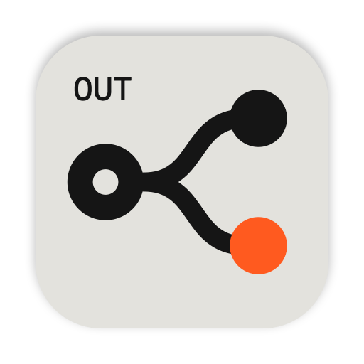

<p align="center"></p>

<h1 align="center">Outputs</h1>

<p align="center">Play your Mac's sound on several outputs at once: Bluetooth and wired headphones, speakers, AirPlay and HDMI. Each output gets its own volume, delay and equalizer, and Outputs keeps them in sync.</p>

<p align="center">
  <a href="https://github.com/theoron-apps/Outputs/releases/latest"></a>
  
</p>

<p align="center"><a href="README.ru.md">Русский</a></p>

## Features

- **Many outputs, one sound.** Pick any outputs from the menu bar and your Mac plays to all of them at the same time.
- **No Bluetooth lag.** Outputs lines the outputs up on its own, and any fine-tuning is remembered for every set of devices.
- **Click test.** Turn the knob until the clicks in every pair of headphones merge into one.
- **Per-app routing and volume.** Pull a cable from an app to an output: music in one pair of headphones, a call in another. Every app also gets its own volume knob.
- **Living patch bay.** Cables sag and swing, you can grab them, and pulses run along the ones that are playing. Pull a plug out and that output stops like a record; plug it back in and it spins up.
- **Volume that makes sense.** Each output has its own volume knob, and your Mac's volume keys control them all at once.
- **Five-band equalizer** with presets for each output.
- **Comes back on its own.** Reconnected headphones rejoin the group, and if one disconnects, the rest keep playing.
- Live menu bar icon, light and dark theme, welcome guide, English and Russian.

No driver to install. Outputs uses Core Audio process taps, so turning it off or quitting puts the sound back exactly as it was.

## Requirements

macOS 14.2 or later.

## Install

Download `Outputs-X.Y.dmg` from Releases, drag Outputs to Applications and open it. The app is ad-hoc signed, so on first launch right-click it and choose Open. The first time you turn Outputs on, macOS asks for permission to capture system audio: click Allow.

## Build

```bash
xcodebuild -project Outputs.xcodeproj -scheme Outputs -configuration Debug build
Scripts/test_dsp.sh
```

`Scripts/build_release.sh` builds a release, installs it to Applications and makes a DMG.

## Privacy

Outputs never records or saves audio and doesn't send anything anywhere. The only network request is a daily check for new versions on GitHub.
