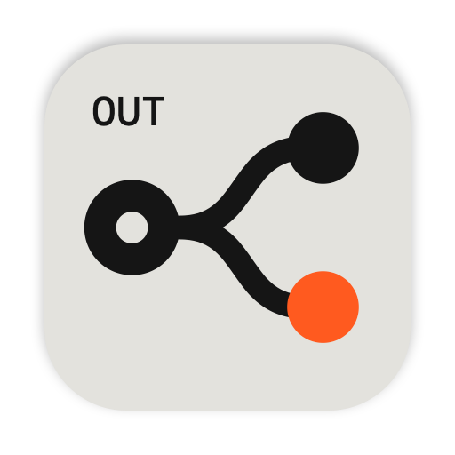

<p align="center"></p>

<h1 align="center">Outputs</h1>

<p align="center">Звук Mac сразу в несколько выходов: Bluetooth и проводные наушники, колонки, AirPlay и HDMI. У каждого выхода своя громкость, задержка и эквалайзер, а Outputs держит их в синхроне.</p>

<p align="center">
  <a href="https://github.com/theoron-apps/Outputs/releases/latest"></a>
  
</p>

<p align="center"><a href="README.md">English</a></p>

## Возможности

- **Много выходов — один звук.** Выберите выходы в меню-баре, и Mac будет играть во все сразу.
- **Bluetooth не отстаёт.** Outputs сам выравнивает выходы, а тонкая подстройка запоминается для каждого набора устройств.
- **Тест щелчками.** Крутите ручку, пока щелчки во всех наушниках не сольются в один.
- **Свои выходы и громкость для приложений.** Протяните кабель от приложения к выходу: музыка в одних наушниках, созвон в других. У каждого приложения своя ручка громкости.
- **Живая коммутационная панель.** Провода провисают и качаются, их можно схватить, а по играющим бегут импульсы. Выдерните штекер — выход остановится, как пластинка, вставьте обратно — раскрутится.
- **Понятная громкость.** У каждого выхода своя ручка, а клавиши громкости Mac управляют всеми сразу.
- **Пятиполосный эквалайзер** с пресетами у каждого выхода.
- **Возвращается сам.** Подключённые снова наушники сами попадают в группу, а если какие-то отключились, остальные продолжают играть.
- Живая иконка в меню-баре, светлая и тёмная тема, гайд первого запуска, русский и английский язык.

Драйвер ставить не нужно. Outputs использует Core Audio taps, поэтому стоит его выключить или закрыть — и звук снова играет как раньше.

## Требования

macOS 14.2 или новее.

## Установка

Скачайте `Outputs-X.Y.dmg` в Releases, перетащите Outputs в «Программы» и откройте. Приложение подписано ad-hoc, поэтому при первом запуске нажмите на него правой кнопкой и выберите «Открыть». Когда вы впервые включите Outputs, macOS спросит доступ к системному звуку — нажмите «Разрешить».

## Сборка

```bash
xcodebuild -project Outputs.xcodeproj -scheme Outputs -configuration Debug build
Scripts/test_dsp.sh
```

`Scripts/build_release.sh` собирает релиз, ставит его в «Программы» и делает DMG.

## Конфиденциальность

Outputs не записывает и не сохраняет звук и никуда его не отправляет. Единственный сетевой запрос — проверка новых версий на GitHub раз в день.

## Лицензия

Outputs можно бесплатно скачивать и использовать. Исходный код открыт под [лицензией PolyForm Noncommercial 1.0.0](LICENSE): его можно читать, собирать и изменять для личного и другого некоммерческого использования, но нельзя продавать или использовать в коммерческих целях. © 2026 Theoron.
